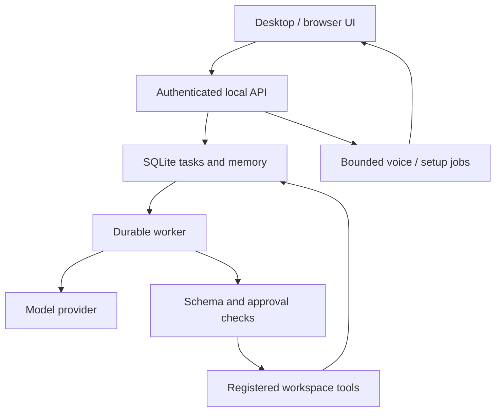

# Architecture

The UI submits answer-mode or tool-mode tasks to the loopback-only API. The single worker stores plans, exact approvals and observed results in SQLite. The model proposes actions; application policy remains authoritative.

Answer mode uses bounded recent context and relevant saved facts without invoking tools. Agent mode plans at most three rounds and twelve total steps. Low-risk failed file observations can cause bounded replanning; actions based on that observation are superseded before execution. Revised plans suppress already completed side effects and associated redundant inspections. Tool-mode responses without an action are reported as failed; answer mode remains separate. Model file writes bind to the latest actually observed same-path hash before exact approval. Changed files fail the final hash check.

State transitions are persisted around each action. After restart, completed actions remain complete, known-safe interrupted work queues automatically, and uncertain side effects pause for inspection. An explicitly paused task stays paused. Automatic safe resume can be disabled through the boolean backend setting resume_safe_after_restart. Pausing does not interrupt an already-running process or model request. The supervisor checks worker health and heartbeat as well as abnormal process exits. It can restart detected failures, but cannot detect every external application or device fault.

Memory is Unicode full-text search. Imports retain URL/time/provenance; source deletion cascades to its memory. Three relevant memories and recent feedback enter later model context when memory access is enabled. This changes retrieval context, not model parameters. Diagnostic records are bounded; user memories and tasks are retained.

The local speech pipeline captures a maximum 20-second mono WAV, validates it, decodes PCM directly and transcribes through CPU-int8 Whisper. English synthesis invokes a separate Piper CLI program with a fixed model and text on stdin, then serves authenticated bounded WAV output to the UI. Background jobs are bounded and session-local; restarting can lose a running job's transient status. Download caches remain managed by their download tools.

## Voice conversation

Voice turns carry a channel and random conversation ID in SQLite. Recent completed voice history is scoped to that session. A bounded structured profile adds a spoken Bengali persona; it cannot grant tool permissions. Exact wake calls have a local fixed reply. RMS end-of-turn detection starts transcription after a pause. Unclear/script-corrupt input is discarded and the assistant asks again; this cannot detect every recognition error. Audio playback completes before microphone capture restarts. Generation counters prevent late transcripts, answers or audio from reviving an ended session. Stop cancels only that voice turn; an already-running tool may finish under the existing task lifecycle.

Whisper large-v3-turbo handles Bengali/auto voice sessions when installed, with small fallback for English. Only one speech model is retained at a time. Piper Bengali has 16 configured speakers; output is served through the same authenticated WAV endpoint. The inference process disables ONNX Runtime telemetry before model sessions are created. Hugging Face download telemetry is disabled. No full-duplex barge-in or persistent wake-word service is claimed.

## Portable shell and commands

NEXUS.exe launches bundled Python, which starts/reuses the source supervisor. A private session.json describes only the authenticated loopback session. Windows Edge/Chrome app mode displays the default orb. A window controller matches the private title and installed executable before minimize/topmost/drag/close; no arbitrary HWND API exists. A detected native-window close requests normal shutdown. Browser-tab close alone is not a backend shutdown signal.

Exact clock/site/app commands bypass LLM planning through fixed registry mappings; app launch still requires approval. Reports are formed only from completed step evidence. Unknown/risky voice mappings clarify or report unsupported. Other voice questions use the real provider with bounded session context. Background model-health checks distinguish configured/available/unknown without network work on the UI thread.
